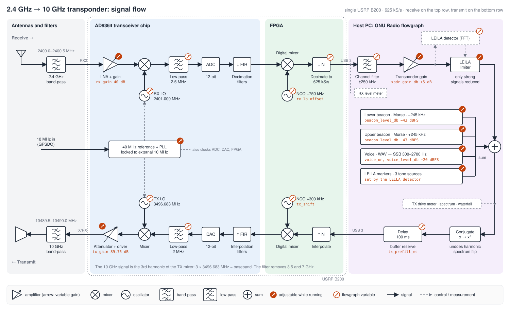

# QO-100 narrowband transponder simulator

A desktop linear transponder that mimics the QO-100 narrowband transponder at short range.
It receives 2400.000–2400.500 MHz and retransmits the same 500 kHz on 10489.500–10490.000 MHz,
so a standard QO-100 station (2.4 GHz uplink, Ku-band LNB downlink) can be tested without the satellite.

- **Hardware:** one USRP B200 (AD9364 transceiver + FPGA), used for receive and transmit at the same time.
- **Software:** GNU Radio flowgraph `qo100_sim_transponder_b200.grc` (saved with GNU Radio 3.10.12).
- **10 GHz trick:** the B200 cannot tune to 10 GHz. It transmits at 3496.683 MHz and the third harmonic
  of its transmit mixer lands on 10.49 GHz. The harmonic mirrors the spectrum, so the flowgraph
  pre-inverts it and the transponder is non-inverting overall.

Extras on top of the plain transponder: two Morse beacons at the band edges, a voice (SSB) channel in
the middle, level meters with overdrive warning, LEILA-style policing of strong uplinks, and an
external 10 MHz reference switch with lock indicator.

## Tested devices

- USRP B200 (single device used for both receive and transmit)

## Signal flow

Assumes a 2.4 GHz band-pass filter on the receive port and a 10 GHz band-pass filter (or a waveguide
that cuts off below about 9 GHz) on the transmit port.

The receive path runs left to right along the top row and the transmit path right to left along the
bottom row. Solid lines carry the signal; dashed lines are measurement and control paths. A filled
orange knob marks something adjustable while the flowgraph runs (slider or checkbox); a hollow knob
marks a flowgraph variable.

Notes on the diagram:

- The B200 contains an AD9364 (single-channel AD936x). The exact split of filtering between the
  chip and the FPGA is chosen by the UHD driver from the requested sample rate; the diagram shows
  the logical stages, not every filter.
- Both local oscillators come from the same 40 MHz reference inside the B200, which can be locked to
  an external 10 MHz input.
- Beacons, voice and markers are added after the limiter, so LEILA never acts on them.

## Frequency plan

| Item | Value | Notes |
|---|---|---|
| Uplink (input) | 2400.000–2400.500 MHz | Centre `rx_center` = 2400.250 MHz |
| RX LO | 2401.000 MHz | `rx_center` + `rx_lo_offset` (750 kHz), keeps the DC spike out of the passband |
| Downlink (output) | 10489.500–10490.000 MHz | Centre `tx_center` = 10489.750 MHz |
| TX LO (fundamental) | 3496.6833 MHz | (`tx_center` + `tx_shift`) / 3 |
| TX LO third harmonic (carrier leak) | 10490.050 MHz | 50 kHz above the top of the passband |
| TX baseband offset | +300 kHz | `tx_shift`, applied in the FPGA |
| Translation | downlink = uplink + 8089.500 MHz | Non-inverting, same as QO-100 |
| Lower beacon | 10489.505 MHz | `tx_center` - `beacon_offset` (245 kHz) |
| Upper beacon | 10489.995 MHz | `tx_center` + `beacon_offset` |
| Voice carrier (USB, suppressed) | 10489.750 MHz | `tx_center` + `voice_offset` (0 Hz) |
| Sample rate | 625 kS/s | `samp_rate`, same for RX and TX |

## Vital parameters

Values are the defaults stored in the flowgraph. Items marked "slider" or "checkbox" can be changed
while it runs; the others are variables edited in GNU Radio Companion.

### Gain and levels

| Parameter | Default | Range | Control | Meaning |
|---|---|---|---|---|
| `rx_gain` | 40 dB | 0–76 | slider | B200 receive gain (AD9364 LNA and following stages) |
| `tx_gain` | 89.75 dB | 0–89.75 | slider | B200 transmit gain; 89.75 is maximum output |
| `xpdr_gain_db` | 5 dB | -20 to 80 | slider | Digital gain of the transponder path |
| `beacon_level_db` | -43 dBFS | -60 to -6 | slider | Level of each beacon, key down |
| `voice_level_db` | -20 dBFS | -60 to -6 | slider | Voice level for a full-scale peak in the audio |
| `voice_on` | off | on/off | checkbox | Enables the voice channel |

dBFS is relative to digital full scale at the transmit drive point (the input of the B200 DAC chain).

### Warning thresholds (level row)

| Parameter | Default | Meaning |
|---|---|---|
| `rx_warn_dbfs` | -12 dBFS | RX peak shown orange above this |
| `rx_clip_dbfs` | -3 dBFS | RX peak shown red above this; the ADC is close to clipping |
| `tx_warn_dbfs` | -12 dBFS | TX drive peak shown orange above this; a starting value, to be calibrated |
| `tx_clip_dbfs` | -2 dBFS | TX drive peak shown red above this; the DAC clips at 0 dBFS |
| Meter window | 100 ms | Peak per 100 ms, plus a 3 s maximum on screen |

### LEILA (strong-signal policing)

| Parameter | Default | Meaning |
|---|---|---|
| `leila_thresh_dbfs` | `beacon_level_db` + 3 = -40 dBFS | A signal whose power in a 2.7 kHz slot exceeds this gets a marker |
| `leila_limit_db` | 6 dB | Signals more than this above the threshold are attenuated back to threshold + 6 dB (-34 dBFS) |
| `leila_marker_dbfs` | `beacon_level_db` = -43 dBFS | Level of the marker (siren) tone |
| Marker tone | +-300 Hz, alternating every 0.2 s | Up to 3 signals marked at once |
| `leila_fft` | 2048 | Analysis resolution, about 305 Hz per bin |
| Reaction time | about 0.1–0.2 s | Detection runs 20 times per second with a 0.4 s peak hold |
| Limiter release | about 20 dB per second | |
| "LEILA marker", "LEILA limiter" | both on | checkboxes |

### Filters, beacons, voice and timing

| Parameter | Default | Meaning |
|---|---|---|
| `passband` | 500 kHz | Channel filter: +-250 kHz, 30 kHz transition |
| RX analog bandwidth | 2.5 MHz | Set on the USRP source |
| TX analog bandwidth | 2.0 MHz | Set on the USRP sink |
| `beacon_wpm` | 12 WPM | Morse speed; 3 s pause between repeats |
| `beacon_lo_text`, `beacon_hi_text` | "VVV DE N0CALL LOWER BCN" / "... UPPER BCN" | Replace N0CALL with your callsign |
| Voice source | `beacon_voice_msg.wav` | 48 kHz mono, looped; the `mic` audio source block is present but disabled |
| Voice filter | 300–2700 Hz, upper sideband | |
| `voice_slack` | 300 ppm | Resampling margin for a live sound card; not needed for the WAV source |
| `tx_prefill_ms` | 100 ms | Transmit buffer reserve against underruns; adds 100 ms latency |
| Reference clock | external 10 MHz | Checkbox switches to the internal oscillator; label shows LOCKED / NOT LOCKED |
| Device | `type=b200` | RX on port RX2, TX on port TX/RX |

## Running it

1. Connect the 2.4 GHz antenna and filter to RX2, and the 10 GHz filter and horn to TX/RX.
2. Protect the receiver: nearby uplinks must be at milliwatt level, or put a 20–30 dB attenuator
   ahead of RX2.
3. Open `qo100_sim_transponder_b200.grc` in GNU Radio Companion, generate and run.
4. If no 10 MHz reference is connected, untick "External 10 MHz ref"; otherwise wait for LOCKED.
5. Receive with a Ku-band LNB: 10489.750 MHz appears at 739.750 MHz with a 9750 MHz LNB oscillator.
6. Check the console: a few `U` at start are normal; continuous `U` or `O` means the PC is not keeping up.

When editing the flowgraph file outside GNU Radio Companion, close it there first, otherwise a later
save from the open window overwrites the change.

## Calibration and checks

- **Receive level:** set `rx_gain` so that normal uplinks stay green on the RX meter. The meter only
  sees the 625 kHz around the passband; strong Wi-Fi a few MHz away can overload the receiver unseen.
- **Transmit linearity:** nothing published says where the third-harmonic output starts to distort.
  Set `beacon_offset` to 20 kHz temporarily, raise the beacon level and watch on the LNB receiver for
  intermodulation products 60 kHz either side of centre. Note the TX drive reading where they reach
  about -40 dB relative to the beacons and set `tx_warn_dbfs` a few dB below it.
- **Carrier leak:** raising the digital levels and lowering `tx_gain` by the same amount should keep
  the output while reducing the leak at 10490.050 MHz.
- **Receiver desense:** compare the RX noise floor with `tx_gain` at maximum and 20 dB lower. A rise
  means the 3.5 GHz fundamental is reaching the receiver.
- **Frequency sense:** an uplink above 2400.250 MHz must come out above 10489.750 MHz.

## Known limits

- LEILA is not a hard protector: the first 0.1–0.2 s of a very strong transmission passes at full level.
- There is no peak clipper before the transmitter; the level row only warns.
- The LEILA thresholds are in dBFS after `xpdr_gain`, so changing the transponder gain changes how
  strong an uplink must be to trip them.
- Without an external reference the translation offset drifts with the B200 oscillator
  (error in ppm x 8089.5 MHz).
- The 10 GHz output is very weak by design (a harmonic); range is a few metres with a bare LNB.
- The band-pass filters are required. Without the 10 GHz filter the B200 radiates its 3.5 GHz
  fundamental, which is in the 5G band.
